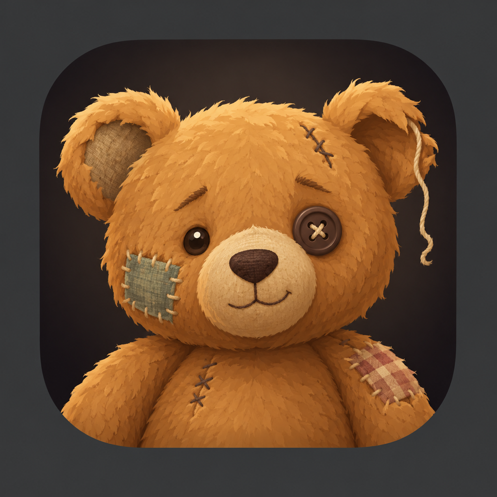
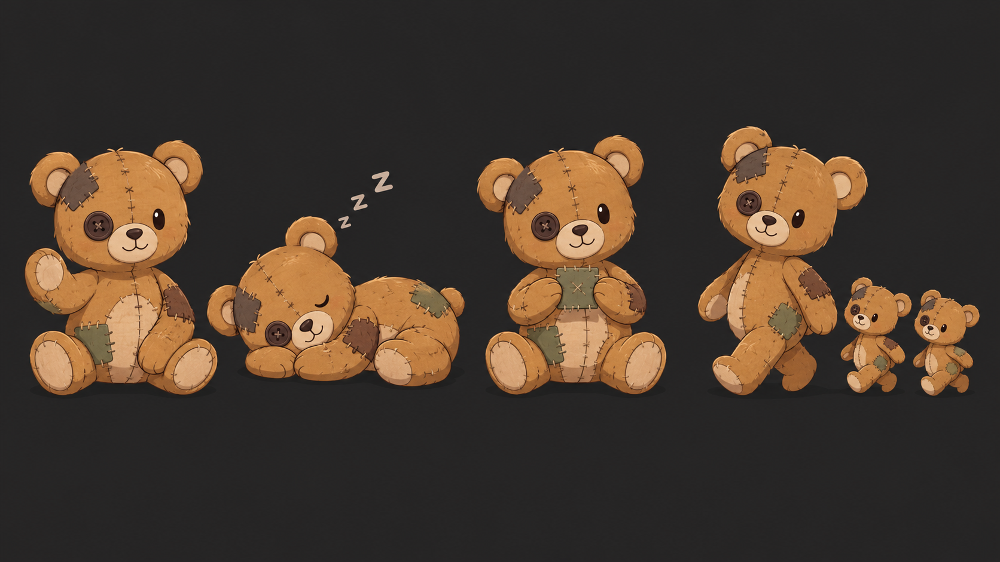
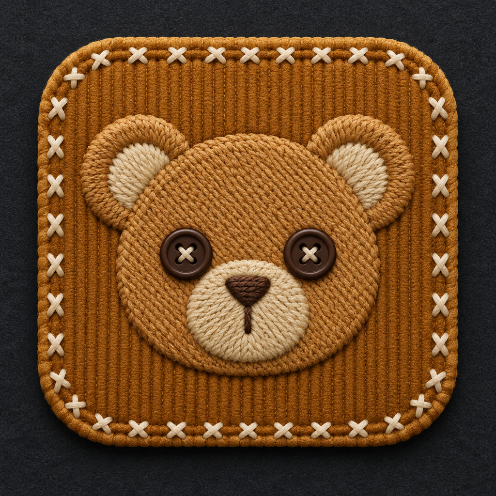
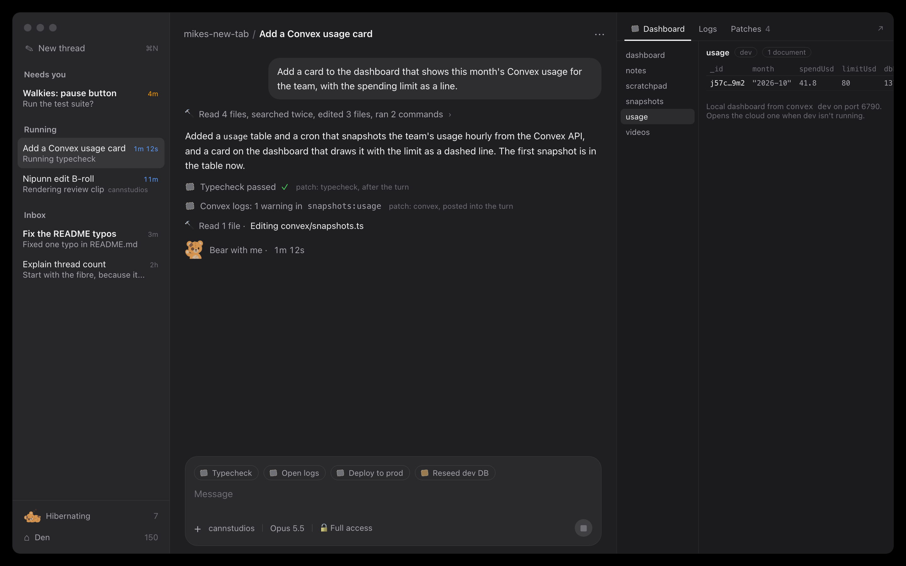
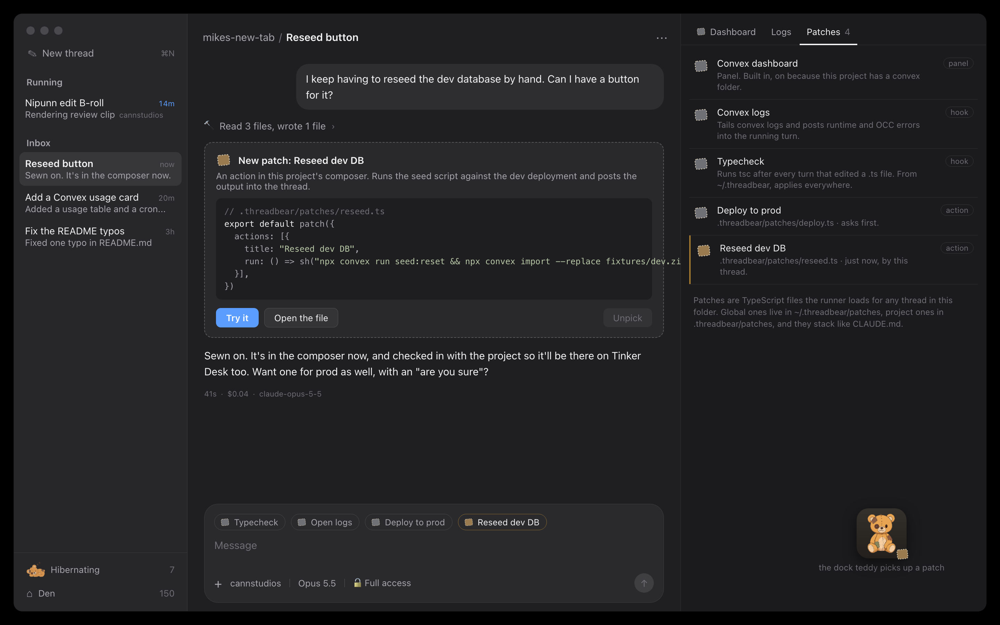
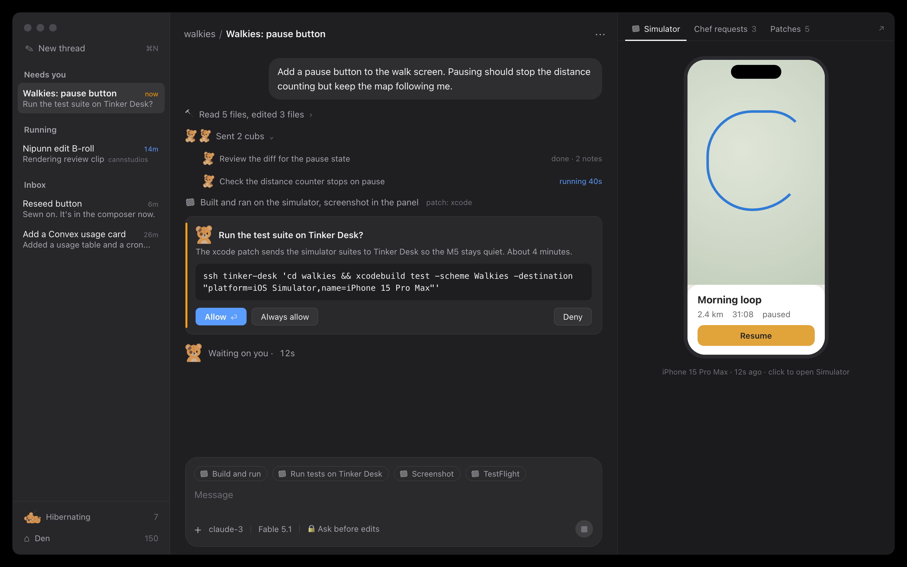
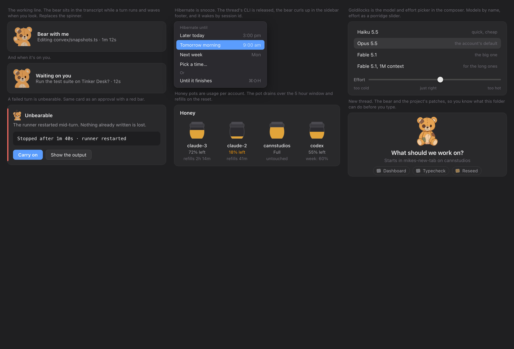

# Quokka Code: the look, and the patches (2026-10-27)

Where this came from: Mike wasn't sold on "Threadbare" as a name but
liked "Quokka Code", wanted the app to be whimsical, and hadn't found the
thing that makes it special. The cat pass (`docs/cat-herder/`) gave it a
personality but no reason to exist. This pass settles both:

- **The bear is the brand.** A threadbare teddy is the one you've had for
  years: worn, patched, held together with string, loved for it. That's
  this app next to T3 or Conductor: not a product, your own thing,
  patched every week, with your history in it.
- **Patches are the feature.** Like the Unity editor, where tools live in
  the project's own code and show up in the editor, a Quokka Code project
  carries patches that extend the app: panels, actions, hooks and tools
  for threads in that folder. The agent can write them. Nobody else's
  agent app lets the agent patch the app.

The mockups are HTML in this folder, rendered with `render.sh`. The
mascot images were generated with OpenAI's image model through Codex
(`.work/codex-*/prompt.txt` has each prompt).

## The mascot

Four directions. The first is the app icon, the second the pose sheet
the in-app sprite would follow, the third a hero illustration for the
README, the fourth an alternative icon.

| | |
|---|---|
|  |  |
|  |  |

My pick is `mascot-a` for the icon and `mascot-b` as the reference for
the flat in-app bear. The embroidered patch (`mascot-d`) is lovely but
reads as a knitting app at dock size. The workbench illustration is the
README hero: a bear patching itself with a laptop open is the whole
idea in one picture.

The in-app bear is a set of generated sprites, not drawn SVG (Mike
didn't like the hand-drawn SVG version). Two sheets were generated from
`mascot-b` as the reference: `sprites/` is the flat, muted,
head-and-shoulders set used in the transcript, cards and footer, and
`sprites-full/` is the full-body set for the empty state and dock. Six
poses each: sit, wave ("bear with me"), sleep (hibernating), holding a
patch, dizzy (unbearable), cub. `cut-sprites.py` keys the white
background out and splits a sheet into transparent PNGs (pure Python
plus `sips`, nothing to install). In the app they'd ship as PNG assets at
2x and 3x; there's no need for them to be vector.

Colour rule, from Mike: keep it quiet. Greys for structure, the accent
blue only on the primary button and a running time, orange only for
"waiting on you", red only for a failure, amber only for honey. Patch
glyphs are grey; a brand-new patch gets a thin amber outline and nothing
else. The bear's own honey-brown is the one warm thing on screen.

## Scenario 1: a Convex project, the dashboard beside the thread



A thread in `mikes-new-tab`. The built-in Convex patch noticed the
`convex/` folder and gave the thread:

- a **panel** on the right showing the local dashboard (port 6790 while
  `convex dev` runs, the cloud one otherwise), on the data tab,
- a **hook** that tails `convex logs` and posts runtime and OCC errors
  into the running turn, so the agent sees them with the code still in
  context (the two patch lines in the transcript),
- **actions** in a row above the composer: Typecheck, Open logs, Deploy
  to prod, and Reseed dev DB from the project's own patch.

The working line is the bear: "Bear with me · 1m 12s". Snooze is
"Hibernating" and Archive is "Den" in the sidebar footer.

## Scenario 2: asking for a button, and getting one



The Unity moment. Mike says "I keep having to reseed the dev database by
hand, can I have a button for it?" The agent writes
`.quokkacode/patches/reseed.ts`, the runner picks it up, and the button
is in the composer before the reply finishes. The transcript shows a
stitched card for the new patch with Try it, Open the file and Unpick.
The Patches tab on the right lists everything applied to this folder and
where each came from (built in, `~/.quokkacode`, or the project). The
dock teddy picks up a patch.

The patch file is deliberately tiny:

```ts
// .quokkacode/patches/reseed.ts
export default patch({
  actions: [{
    title: "Reseed dev DB",
    run: () => sh("npx convex run seed:reset && npx convex import --replace fixtures/dev.zip"),
  }],
})
```

## Scenario 3: an iOS project, the simulator beside the thread



A Walkies thread. An `xcode` patch gives it a Simulator panel (the last
screenshot, click to open the real Simulator), Build and run, tests on
Tinker Desk so the M5 stays quiet, Screenshot and TestFlight actions,
and a hook that builds after edits. A Chef requests tab shows the
feature list from prod. Sub-agents are cubs: "Sent 2 cubs" folds like a
work group, each cub a line with its state. The approval card is plain,
with the bear sat in it, and the waiting line is "Waiting on you".

## The bear bits



- **Bear with me** is the working line. The bear waves while a turn
  runs. It's the one animation worth doing well, because waiting is
  most of what an agent app is.
- **Hibernate** is snooze. The menu has the presets plus "Until it
  finishes". The runner already hibernates idle CLIs after 30 minutes
  and wakes them by session id, so the word is literal.
- **Unbearable** is a failed turn, the approval card shape with a red
  bar, "Carry on" as the primary action.
- **Honey pots** are usage per account, drained over the 5 hour window.
  This is step 4's Token Stats work in a form you can read across the
  room.
- **Goldilocks** is the model and effort picker: models by name, effort
  as a slider from too cold to too hot. Build this regardless.
- **New thread** shows the bear and the folder's patches, so you know
  what the project can do before you type.

## How patches work

A patch is a TypeScript module the runner (already Node) loads for any
thread whose cwd is inside the folder that holds it. Patches stack like
CLAUDE.md: `~/.quokkacode/patches/` applies everywhere, then each
parent folder, then the project's `.quokkacode/patches/`. Built-in ones
ship with the app and switch on by a condition (a `convex/` folder, an
`.xcodeproj`, a `.tandem` file). A patch can export:

| Export | Where it shows up | Example |
|---|---|---|
| `panels` | The right-hand panel bar. A URL in a web view, or HTML the patch serves | Convex dashboard, Simulator, Sanity preview, Storybook, a Playwright report |
| `actions` | Chips above the composer and in the thread menu. Run a command and post its output, or send a canned prompt | Typecheck, Reseed, Deploy, Build and run |
| `hooks` | Run on thread events; output goes into the transcript as a patch line | Typecheck after a turn that edited `.ts`, tail logs into the running turn |
| `tools` | Extra MCP tools on the session, through the in-process server the runner already builds | "reseed the dev database", "render frame N" |

Loading repo code into the runner is the same trust as `npm install`,
and these are Mike's own repos. A patch written by a thread is a normal
file in the repo, so it's reviewed and committed like anything else,
and it's there on Tinker Desk the next time a thread runs there.

Thread stays on one cwd. A thread that needs two projects runs in a
worktree or a parent folder; "multiple projects" isn't a thread concept,
it's where the patches stack from.

(2026-10-27: superseded by `docs/projects-design.md`. A thread can now be
in several projects, each with several folders, and loads patches from
all of them.)

## Build order

1. **Goldilocks and the bear working line.** Small, and the app feels
   like Quokka Code straight away. Includes the hibernate menu copy and
   the sidebar footer. About a day. Landed 2026-10-27: the app is
   called Quokka Code, the working line is "Bear with me · 12s" with the
   waving sprite, Snooze is Hibernate (Wake to undo), Archive is Den,
   the effort menu has the porridge under each level, and the icon is
   `mascot-a` (`app/icons/make-icon.swift` cuts it out of the tile).
2. **Panels from a manifest.** The panel bar, web view panels, built-in
   Convex (dashboard URL) and xcode (Simulator screenshot) patches. The
   Convex dashboard alone pays for it. A day or two. Landed 2026-10-27:
   the runner's `patches.ts` gives a thread its panels in the summary
   (`panels`), the app shows them in a pane on the right with tabs along
   the top, an Open in browser arrow and a draggable width; the Convex
   panel is the real dashboard for the deployment in `.env.local`, the
   Simulator panel asks the runner for a fresh screenshot every few
   seconds (`panels.render`). Panels are built in for now; the project's
   own patch files are step 3.
3. **Actions and the patch loader.** `.quokkacode/patches/*.ts` loaded
   by the runner, action chips, the stitched "New patch" card, the
   Patches tab. This is the scenario 2 moment. Two days. Landed
   2026-10-27, minus the card and the tab: patch files are plain modules
   whose default export lists `actions` (`run` a command or `prompt` a
   message) and `panels` (a `url`), the runner reads them again within 15
   seconds of a change and says in the transcript when one appears or
   breaks, the chips sit above the composer's text, and a command's
   output lands in the transcript as a tool-style row with the patch
   glyph. `tb actions` and `tb run` do the same from a shell. The patch
   file shape question is settled: one file per patch, declarative.
4. **Hooks.** Turn-end and file-change hooks posting into the
   transcript; the Convex logs hook. A day. Landed 2026-10-27 as
   `hooks` in a patch file: `on: "turn.end"` with an optional `edited`
   glob, posted into the transcript like an action and, when it fails
   (or always, or never), sent to the agent as a message from the runner
   so it fixes what it broke, told twice in a row at most. The Convex
   logs hook (tailing `convex logs` into a running turn) needs a
   long-running process per thread and a trigger while the turn runs;
   it's the next hook trigger to add, not done yet.
5. **Tools and honey pots** fold into step 4 of the main plan (Codex,
   accounts, usage) since both need the same plumbing.
6. **App icon and dock states** from `mascot-a`, the dock teddy picking
   up patches. Half a day, any time.

## Open questions for Mike

- Icon: went with `mascot-a` (the bear). Easy to swap for `mascot-d`.
- Does the sidebar keep plain words ("Needs you", "Running", "Inbox")
  with the bear only in the transcript, dock and footer? That's what
  the mockups do, and I'd keep it that way: the bear is the app's
  mascot, not one per thread.
- Patch file shape: settled as one file per patch with a plain default
  export (docs/protocol.md, Patches). Hooks and tools will join
  `actions` and `panels` in the same object.
